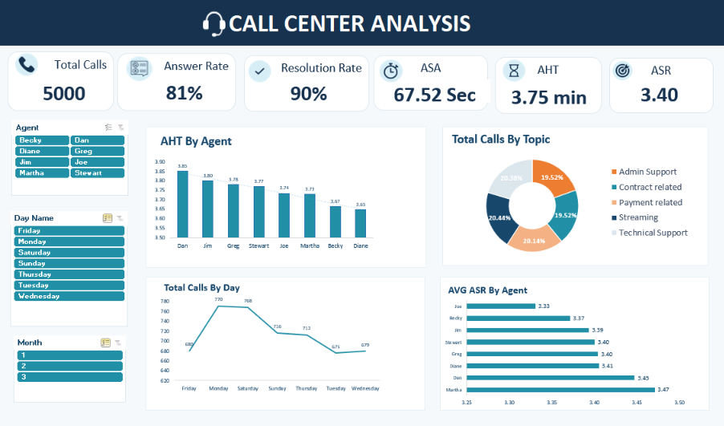
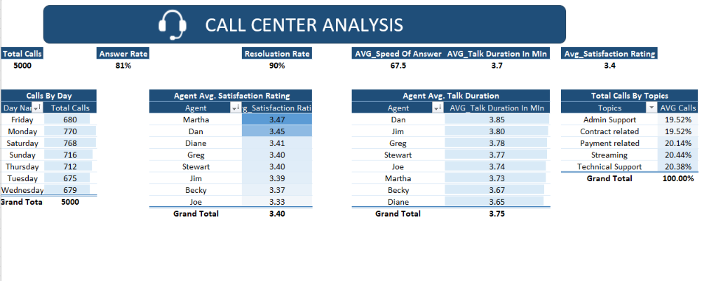

# 🎧 Call Center Analysis Dashboard

**Excel dashboard built with Power Query, Power Pivot (DAX), and Pivot Tables**

An interactive Excel dashboard that analyzes **5,000 customer calls (Jan to Mar 2021)** to monitor call volume, answer and resolution rates, response speed, call duration, and customer satisfaction, for the whole center and for each of its 8 agents.



---

## 📌 Table of Contents
- [Business Problem](#-business-problem)
- [Dataset](#-dataset)
- [Tools & Technologies](#-tools--technologies)
- [Project Workflow](#-project-workflow)
- [Dashboard](#-dashboard)
- [KPIs](#-kpis)
- [Key Insights](#-key-insights)
- [Skills Demonstrated](#-skills-demonstrated)
- [Repository Structure](#-repository-structure)

---

## 🎯 Business Problem
A call center manager needs one view to answer:
- How many calls come in, and on which days and topics?
- How many calls are answered and how many of those are resolved?
- How fast do agents answer, and how long do calls last?
- How satisfied are customers, and how do agents compare?

---

## 📂 Dataset
`data/01-Call-Center-Dataset.xlsx`: **5,000 calls, 8 agents, 5 topics, 90 days (1 Jan to 31 Mar 2021).**

| Column | Meaning |
|---|---|
| Call Id | Unique ID of each call |
| Agent | Agent who handled the call (8 agents) |
| Date / Time | When the call started |
| Topic | Admin Support, Contract related, Payment related, Streaming, Technical Support |
| Answered (Y/N) | Whether the call was answered |
| Resolved | Whether the issue was resolved |
| Speed of answer in seconds | Customer wait time before an agent answered |
| AvgTalkDuration | Talk time of the call |
| Satisfaction rating | Customer rating, 1 to 5 |

Unanswered calls (946) have no wait time, talk time, or rating, so those averages use answered calls only.

---

## 🛠 Tools & Technologies
| Layer | Tool |
|---|---|
| Data Preparation | Power Query |
| Data Model | Power Pivot (Excel Data Model) |
| Calculations | DAX measures |
| Analysis | Pivot Tables |
| Visualization | Excel charts, slicers, KPI cards |

---

## 🔄 Project Workflow

**1. Data preparation (Power Query)**
- Imported the data and checked every column with Column Quality for errors and missing values.
- Fixed data types for Time, Speed of Answer, and Satisfaction Rating.
- Converted the talk duration from time format to seconds:
  `Time.Hours([AvgTalkDuration]) * 3600 + Time.Minutes([AvgTalkDuration]) * 60 + Time.Seconds([AvgTalkDuration])`
  then to minutes.

**2. Date table**
Built a dedicated Date table (Date, Day, Day Name, Month, Month Name, Year, Quarter) to support time analysis.

**3. Data model**
Loaded both tables to the Data Model and created the relationship in Power Pivot.

**4. Measures and KPIs (DAX)**
Total Calls, Answer Rate (answered ÷ total calls), Resolution Rate (resolved ÷ answered calls), Average Speed of Answer, Average Talk Duration, and Average Satisfaction Rating.

**5. Pivot tables**
Calls by Day, Satisfaction by Agent, Talk Duration by Agent, and Calls by Topic.

**6. Dashboard**
Combined the KPIs, charts, and slicers (Agent, Day Name, Month) into one interactive page.



---

## 📈 KPIs
| KPI | Value |
|---|---|
| Total Calls | 5,000 |
| Answer Rate | 81% (4,054 answered, 946 not answered) |
| Resolution Rate | 90% of answered calls |
| ASA (Average Speed of Answer) | 67.52 seconds |
| AHT (Average Talk Time) | 3.75 minutes |
| ASR (Average Satisfaction Rating) | 3.40 out of 5 |

---

## 💡 Key Insights
1. **Nearly 1 in 5 calls goes unanswered.** 946 calls (19%) were never answered, and **Technical Support** is the weakest topic with the lowest answer rate (79.0%) and the most missed calls (214).
2. **Volume peaks on Monday and Saturday** (770 and 768 calls) and is lowest on Tuesday and Wednesday (about 675). January was the busiest month (1,772 calls vs about 1,615 in February and March).
3. **Satisfaction is average, not strong.** The mean rating is 3.40, and about 20% of rated calls scored 1 or 2 stars. Agent scores are close (3.33 to 3.47), with **Martha** highest and **Joe** lowest.
4. **Agents are consistent on speed and duration.** Talk time ranges from 3.65 min (Diane) to 3.85 min (Dan). Joe also has the slowest average answer time (about 71 seconds), which may relate to his lower satisfaction score.
5. **Calls are evenly spread across topics** (19.5% to 20.4% each), so no single topic dominates the workload.

---

## 🧠 Skills Demonstrated
`Excel` • `Power Query` • `Power Pivot` • `DAX` • `Pivot Tables` • `Data Modeling` • `KPI Design` • `Dashboard Design` • `Data Analysis`

---

## 📁 Repository Structure
```
call-center-analysis-excel/
├── README.md
├── Call_Center_Analysis.xlsx      # full project: Power Query, data model, pivots, dashboard
├── data/
│   └── 01-Call-Center-Dataset.xlsx  # raw dataset
└── images/
    ├── Dashboard.png
    └── Pivote_tables.png
```

---

## ▶️ How to Use
1. Download `Call_Center_Analysis.xlsx` and open it in desktop Excel (Power Query and Power Pivot need the desktop version).
2. Go to the **Dashboard** sheet and use the slicers (Agent, Day Name, Month) to filter every visual.
3. The **Pivot Tables** and **Steps** sheets show how each number was built.

---

